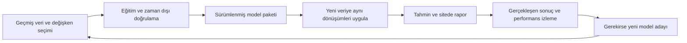

# Yeni veri ve model yaşam döngüsü

Tarih: **6 Kasım 2026**. Durum: tasarım. İki iş akışı vardır: [model geliştirme/eğitim](../model_oncesi/README.md) ve [ürün/tahmin/işletim](README.md). İkincisi sahadaki sonuçlarla birincisine geri besleme sağlar; ilk modelin tamamlanması araştırmanın sonsuza kadar bittiği anlamına gelmez.

## 1. İki tarafın ilişkisi

Site ve model araştırması kısmen paralel geliştirilebilir. Gerçek tahmin yayımlamak için kullanılabilir ve kapsamı belli model paketi gerekir. İlk arayüz prototipinde örnek veri kullanılıyorsa bu açıkça örnek olarak işaretlenir.

## 2. Model öncesi tarafın teslim edeceği paket

| Parça | İçerik |
|---|---|
| Model | Eğitilmiş model veya kalem/model topluluğu dosyaları ve bütünlük özeti |
| Girdi sözleşmesi | Seçilen kesin özellikler, adlar, türler, sıra gerekiyorsa sıra, birim ve dönem tanımları |
| Özellik dönüşümleri | Aynı hesaplama kodu/sürümü; eğitimde öğrenilmiş ölçekleme, eksik doldurma ve diğer parametreler |
| Hedef/dönüşüm sözleşmesi | Tahmin edilen kalem ve ufuklar; hedef dönüşümünü geri alma ve varsa muhasebe hesapları |
| Kapsam | Desteklenen şirket/sektör şeması, yeterli geçmiş ve eksik veri koşulları |
| Araştırma kaydı | Eğitim bilgi kesimi, veri sürümü, kıyaslar ve dönem dışı sonuçlar |
| Sürüm | Model, özellik tanımı ve çalışma ortamı sürümleri; önceki kullanılabilir paket |

[Aday değişken listesi](../model_oncesi/DEGISKEN_LISTESI.md) bir araştırma havuzudur. Bir modelin gerçek girdi sözleşmesi bu havuzdan seçilmiş ve sabitlenmiş alt kümedir. Listeye aday eklenmesi veya öncelik değiştirilmesi çalışan modelin boyutunu/anlamını değiştirmez.

## 3. Yeni veri geldiğinde olağan akış

1. Yeni kaynak/veri sürümü alınır; ilk açıklama, kullanılabilirlik ve dönem bilgisi korunur.
2. Şirket/hedef için model kapsamı, birim ve veri koşulları doğrulanır.
3. Paketin tanımladığı özellik hesapları uygulanır; öğrenilmiş dönüşüm parametreleri aynen kullanılır.
4. Hazır model yeni girdilerle tahmin üretir; model sürümü değişmez.
5. Sayısal sonuç, kaynak anlık görüntüsü ve model sürümüyle saklanır; rapor tamamlanınca görünür yapılır.

Örneğin kur veya GPR değeri değiştiğinde şirketin yeni özellikleri modele verilir. Modelin ağırlıkları o sayfa açılışında kendiliğinden değişmez. İş ilişkilerinin öğrenilmesi ve yeni parametrelerin bulunması eğitim işidir.

Eğitimdeki ön işlemenin sonraki veride de uygulanması ve öğrenme adımlarının test verisine taşınmaması resmi [scikit-learn rehberinde](https://scikit-learn.org/stable/common_pitfalls.html) açıklanır. Buradaki kural; eğitimden öğrenilmiş parametreleri yeni veriyle otomatik yeniden öğrenmemektir. Şirketin bilinen aktifine göre ölçek gibi tanımlanmış gözleme bağlı hesaplar, sabit tanımlarıyla yeni gözlemde doğal olarak yeniden hesaplanır.

## 4. Gerçek finansal sonuç açıklanınca

- O dönem için önceden üretilen tahmin ve bilgi kesimi korunur.
- Gerçekleşen değer, ilk açıklanan/son düzeltilmiş sürüm politikasıyla ayrıca kaydedilir.
- Kalem bazında hata, basit kıyasla fark ve varsa aralık kapsaması ölçülür.
- Henüz açıklanmamış yeni hedef için uygun tahmin hazırlanır.
- Yeni gerçekleşen veri, ancak eğitim kesiminde biliniyorsa sonraki eğitim veri setine eklenebilir.

Sayfanın bugün güncellenmesi, eski tahminin zaman damgasını veya o tarihteki girdilerini değiştirip sonucu daha iyi göstermemelidir.

## 5. Ne zaman yeniden eğitim düşünülür?

| Gözlem | İlk tepki | Yeniden eğitim ilişkisi |
|---|---|---|
| Yeni veri aynı girdi sözleşmesine uyuyor | Yeni tahmin üret. | Tek başına eğitim gerektirmez. |
| Veri dağılımı veya eksikliği değişiyor | Kaynak/işleme ve kapsamı incele. | Modelin bozulduğunu tek başına kanıtlamaz; araştırma tetikleyebilir. |
| Yeterli yeni gerçekleşende hata kalıcı artıyor | Kıyasları, şirket/kalem/tarih kırılımlarını değerlendir. | Yeni aday model için gerekçe olabilir. |
| Gerçek bir veri/işleme hatası bulundu | Hatalı adımı/sürümleri düzelt; etkileneni belirle. | Tahmin yenileme veya eğitimin tekrarı etkilenme kapsamına göre seçilir. |
| Kullanılacak özellik/raporlama tanımı değişiyor | Yeni girdi/etiket sözleşmesini hazırla. | Uyumlu yeni model paketi doğrulanır. |
| Kapsama yeni şirket/sektör giriyor | Mevcut modelin şeması ve kapsamıyla uyumu kontrol et. | Her yeni şirket zorunlu yeniden eğitim demek değildir; kapsam dışı genelleme de varsayılmaz. |

Haftalık veri yenileme, otomatik haftalık yeniden eğitim kararı değildir. İlk sürümde performans incelemesi ve aday model seçimi ekibin belirlediği ölçütlerle yapılır; çevrim içi öğrenme varsayılmaz. Çeyreklik finansal hedeflerde yeni doğru cevaplar gecikmeli ve sınırlı sayıda gelir; bir veya iki şirketin sonucu genel başarı sayılmaz.

## 6. Yeni model sürümünü kullanıma alma

1. Aday sürüm model öncesi tarafta geçmişe uygun eğitim/doğrulamayla hazırlanır.
2. Mevcut sürüm ve basit kıyaslar ile ortak gözlemlerde karşılaştırılır; sabit test sonuçlarına tekrar tekrar bakarak ayar yapılmaz.
3. Girdi uyumu, model kalitesi ve çalışma maliyeti birlikte incelenir.
4. Yayın ölçütleri karşılanırsa aktif paket işaretçisi yeni sürüme geçirilir; eski paket korunur.
5. Yeni işler yeni sürümü kullanır; mevcut raporlar model sürümünü korur, gerektiğinde arka planda yenilenir.
6. Sorun çıkarsa önceki uyumlu pakete dönülebilir; geçmiş sonuçlar silinmez.

Eğitim ve sunum arasında farklı özellik hesaplarının oluşması, ayrıca izlenmesi gereken bir problemdir. [Google'ın ML mühendisliği rehberi](https://developers.google.com/machine-learning/guides/rules-of-ml) bu eğitim–sunum tutarsızlığına ve ölçüme dikkat çeker. Ortak özellik/veri tanımlarının tek kaynakta kalması bu yüzden iki çalışma alanını birbirine bağlar.

## 7. Belgelerin sorumluluk sınırı

| İş | Ana alan |
|---|---|
| Makaleler, yöntem seçimi, özellik hipotezi | Model öncesi |
| Tarihsel eğitim verisi ve dönem dışı deney | Model öncesi |
| Model ve dönüşüm paketini üretmek | Model öncesi |
| Site, API, veri toplama kuyruğu ve güncel rapor | Model sonrası |
| Canlı veriyle yeni tahmin ve arşiv | Model sonrası |
| Sahadaki gerçekleşen/hata kaydı | Model sonrası; eğitim tarafına geri besleme |
| Yeniden eğitim ve yeni adayın bilimsel değerlendirmesi | Model öncesi; kullanıma alma model sonrası |

## 8. Geliştirici deneyimi notları

İki yazının tam metni ve yorumları incelendi; yorum bulunmadı. Bunlar resmi rehberlere ek açıklamalardır; evrensel model bozulma süresi, otomatik yeniden eğitim eşiği veya araç zorunluluğu çıkarmıyoruz.

- 🔄 [Training-Serving Skew. The Silent Model Killer](https://dev.to/timeai/training-serving-skew-the-silent-model-killer-2abl) [@timeai](https://dev.to/timeai) — Eğitim ve kullanımda farklı eksik veri/özellik hesaplarının aynı modelde tutarsız girdiler yaratabilmesi, ortak dönüşüm sözleşmesini gerekçelendiriyor. 🔗 [Read Full Discussion on DEV](https://dev.to/timeai/training-serving-skew-the-silent-model-killer-2abl)
- 📉 [Feature Drift & Concept Drift — Why Models Rot in Production (Part 3)](https://dev.to/ashish_ghadigaonkar_/feature-drift-concept-drift-23jj) [@ashish_ghadigaonkar_](https://dev.to/ashish_ghadigaonkar_) — Girdi dağılımını izlemekle gerçekleşen sonuçlarda performansı izlemek ayrı işler olduğundan, yeniden eğitim kararı bu iki gözlemi ayırır. 🔗 [Read Full Discussion on DEV](https://dev.to/ashish_ghadigaonkar_/feature-drift-concept-drift-23jj)

Çalışma sırası: doğrulanmış paket üret, yeni veriyle sürümlü tahmin sun, gerçekleşenleri izle ve gerektiğinde yeni aday geliştir.
