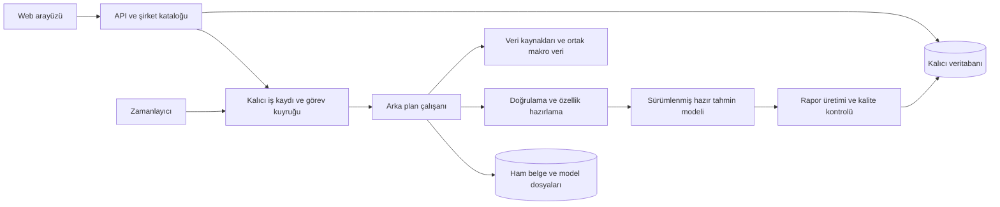

# Sistem mimarisi önerisi

Tarih: **6 Kasım 2026**. Durum: **tasarım önerisi; uygulama kurulmadı**. Ürün hedefinin kaydı [İstenilen Hedef](ISTENILEN_HEDEF.md) belgesindedir. Bu belge veri hazırlama, tahmin, rapor saklama ve yenileme akışını kapsar.

Çalışma alanı: [model sonrası / ürün ve işletim](README.md). Modelin eğitimi ve doğrulaması [model öncesi](../model_oncesi/README.md) taraftadır. İki tarafın paket/sürüm geçişi ve yeniden eğitim ilişkisi [model yaşam döngüsünde](MODEL_YASAM_DONGUSU.md) açıklanır.

## 1. Karar önerisi: ortak işlem hattı, iki başlatma biçimi

**Talep üzerine ilk hazırlık + kalıcı rapor + düzenli artımlı güncelleme.** Kullanıcının iki seçeneği aynı işlem hattını farklı nedenlerle başlatabilir. Birinci seçenek ilk erişim/kapsama maliyetini, ikinci seçenek güncelliği yönetir.

| Yaklaşım | Güçlü taraf | Sınır | Bu proje için değerlendirme |
|---|---|---|---|
| Yalnız ilk talepte hazırlama | Talep edilen hisselere işlem yapar. | İlk ziyaret bekler; hazır raporlar zamanla eskiyebilir. | İlk prototipte iyi bir başlangıç; güncelleme politikası gerekir. |
| Yalnız haftalık toplu üretim | Önceden hazır rapor kapsamı artar. | İlk büyük veri toplama ve dönemsel yük; yeni bilgi bir sonraki taramayı bekleyebilir. | Tüm geçmişi tekrar indirmeden, şirket bazında parçalara bölünerek uygulanabilir. |
| Önerilen birleşim | Hazır rapor hızlı açılır; eksik şirket talepte hazırlanır; düzenli kontrol güncelliği sağlar. | İş kuyruğu ve sürüm takibi gerekir. | Dört kişilik ekip için tek uygulama kod tabanıyla kademeli kurulabilir. |

Bir raporu tekrar göstermek için dış kaynaktan veri toplamak veya modeli yeniden eğitmek gerekmez. Hazır raporun esas kaydı kalıcı veritabanındadır; kısa ömürlü önbellek yalnız sonradan gerekirse eklenir.

## 2. Bileşenler

Arayüz veri çekme/tahmin işini kendisi yapmaz. API, kalıcı durumu okur ve gerekiyorsa iş başlatır. Ağır iş API isteğinin tamamlanmasına bağlanmadan worker sürecinde yürür. FastAPI kullanılırsa resmi doküman da ağır işler için ayrı süreç/kuyruk yaklaşımını ayırır. [FastAPI arka plan işleri](https://fastapi.tiangolo.com/tutorial/background-tasks/#caveat)

## 3. Dört kişilik ekip için uygulama sınırı

İlk kurulumda tek kod tabanı, bir API süreci, bir worker ve bir zamanlayıcı yeterli başlangıçtır. Tek sunucuda ayrı süreçler/konteynerler olabilir; ileride worker sayısı artırılabilir. İşlem adımları kod içinde modüller olarak ayrılır; her biri için ayrı ağ servisi gerekmez.

Uygulama adayı: **Python API (örneğin FastAPI), PostgreSQL, hazır Python iş kuyruğu (örneğin RQ + Redis) ve standart bir zamanlayıcı**. Bunlar teknoloji adaylarıdır; web arayüzü çerçevesi ve barındırma kararı bu belgede kesinleştirilmez. SQL veritabanında ilişkiler/sürümler, dosya deposunda ham belgeler/model dosyaları tutulur.

RQ Python fonksiyonlarını ayrı worker'da çalıştırır; zaman aşımı ve tekrar deneme seçenekleri vardır. Kuyruk sonucunun varsayılan saklama süresi kısa olabilir; uygulamanın kalıcı raporu kuyruk sonucuna bırakılmaz. [RQ işleri](https://python-rq.org/docs/), [tekrar denemeler](https://python-rq.org/docs/exceptions/)

MVP'de kalıcı dosya alanı ve yedekleme kullanılabilir; birden çok sunucuya geçilirse ortak nesne deposu gerekir. Geçici `/tmp` dizini rapor arşivi olarak kullanılmaz.

## 4. Şirket kataloğu ve arama

Katalog, ayrıntılı finansallardan önce hazırlanır. Şirket adı, sabit şirket kimliği, aktif hisse kodu, eski kodlar/arama adları, sektör/faaliyet etiketleri ve kapsam durumu bulunur. “THY” gibi bir arama, katalogdaki THYAO kaydını bulabilir; arama harfleri yazılırken bütün eşleşmeler için ağır işlem başlatılmaz.

**Hisse seçildiğinde** şirket sayfası açılır. Tek sayfa şablonu ve şirket koduna göre yönlendirme kullanılır; her hisse için yeni site kurma/yayınlama işlemi yoktur. Sabit şirket kimliği, değişebilen hisse kodundan ayrıdır. Bir şirketin birden fazla menkul kıymeti bulunursa şirket düzeyindeki finansal rapor gereksiz yere çoğaltılmaz.

Katalog kaynağı ve güncellemesi için resmi şirket/bildirim bilgileri veya seçilecek uygun veri sağlayıcısı kullanılır. KAP şirket listeleri, sektör bilgileri ve bildirim sorgularını açıklar; bu sayfaların varlığı, ihtiyaç duyduğumuz otomatik veri arayüzünün seçilip kurulmuş olduğu anlamına gelmez. [KAP yardım](https://kap.org.tr/tr/icerik/Diger/yardim)

## 5. İlk talep akışı

1. API şirketi ve model/veri kapsamını doğrular.
2. İstenen hedef dönem için geçerli rapor varsa veritabanından döner.
3. Rapor yoksa aynı şirket/hedef için aktif iş var mı bakılır; varsa mevcut işin kimliği döner.
4. Yoksa kalıcı iş kaydı oluşturulur ve iş kuyruğuna aktarılır.
5. Arayüz “hazırlanıyor” durumunu gösterir; iş durumunu kısa sorgularla takip edebilir.
6. Worker kaynakları alır, gerekli geçmişi tamamlar ve veriyi doğrular.
7. Özellik sürümüne göre bir girdi anlık görüntüsü oluşturur; mevcut modelle tahmin yapar.
8. Rapor kontrolleri geçerse rapor kalıcı kaydedilir ve görünür sürüm atomik olarak değiştirilir.

Sayfa kapansa da iş devam edebilir. Kullanıcı daha sonra dönerse aynı başarılı sonucu görür. Uzun süren işlemin HTTP bağlantısını açık tutmaya gerek yoktur. Yeni iş oluşturma için `202 Accepted` ve iş durumu adresi uygun bir sözleşmedir; bu kod işlemin tamamlandığı anlamına gelmez. [HTTP 202](https://www.rfc-editor.org/rfc/rfc9110.html#name-202-accepted)

## 6. Tekrar ziyaret ve eskime

| Durum | Ekran | Arka plan davranışı |
|---|---|---|
| Geçerli hazır rapor var | Saklanan rapor ve tarihleri | Sayfa açılışı dış kaynak taraması beklemez. |
| Rapor var, yenileme zamanı gelmiş | Mevcut rapor, bilgi tarihi ve güncelleme durumu | Tek güncelleme işi oluşturulabilir; eski sonuç silinmez. |
| İlk hazırlık sürüyor | Anlaşılır hazırlık durumu | Aynı işe bağlanılır. |
| Önceki rapor var, yeni işlem başarısız | Tarihiyle mevcut başarılı rapor | Hata kaydı ve kontrollü tekrar deneme. |
| Veri yetersiz/model kapsamı dışı | Durumu açıklayan şirket sayfası | Desteklenmeyen şemaya uydurma tahmin üretilmez. |

Veri eskime durumu ile işin çalışıp çalışmaması ayrı alanlardır. Kuyruk durumunun `completed` olması tek başına raporun bugün için güncel olduğunu söylemez. Raporun hedefi artık açıklanmışsa sonuç arşiv/karşılaştırma olarak kalır; güncel tahmin bölümü henüz açıklanmamış uygun hedefe geçer.

## 7. Düzenli güncelleme politikası

Haftalık tarama ilk araştırma sürümü için bir **üstten kontrol** olabilir; bütün veri türlerinin doğal güncelleme sıklığı değildir. Kesin aralık kaynak erişimi ve pilot maliyetinden sonra ayarlanır.

| İş | Önerilen başlangıç politikası |
|---|---|
| Şirket kataloğu | Düzenli küçük kontrol; yeni kod/kapsam değişimlerini işle. |
| Yeni finansal bildirim/düzeltme | Kaynak destekliyorsa daha sık küçük bildirim taraması; değişen şirketi sıraya al. |
| Ortak makro ve GPR/GEPU/OFR | Her kaynağın yayın ritmine göre bir kez al; bütün şirketler aynı merkezi veriyi kullanır. |
| Hazır raporlar | Yeni önemli girdi, hedef dönem veya model/özellik sürümü varsa yenile. |
| Haftalık kontrol | Desteklenen evrendeki eksik/eski raporları tara; değişmeyeni atla. |
| İlk tarihsel veri hazırlığı | İhtiyaç duyulan geçmişi bir kez al; daha sonra yeni bildirim ve düzeltmeleri artımlı işle. |

Ortak makro serilerini her şirket için yeniden indirmeyiz. Ortak veri değişince etkilenebilecek raporlar işaretlenir ve kaynak sınırları içinde parça parça yenilenir. Büyük güncellemeler tüm raporları aynı anda silmez. Haftalık listede hiçbir girdi değişmediyse aynı raporu sebepsiz yeniden üretmek zorunlu değildir.

Yeni bildirimin bilinen kayıttan farklılığı kaynak sürümü/içerik özetiyle saptanır. Sadece “son kontrol saati değişti” diye ağır tahmin işi başlatılmaz. Özelliklerde veri yaşı/takvim kullanılıyorsa bunların değişimi de girdi sürümüne dahildir. Düzeltme taramasında geçmiş bildirimler için makul örtüşen pencere korunur; eski sürümler silinmez.

## 8. Model eğitimi ile rapor üretimi

**Model eğitimi**, birden çok şirketin tarihsel örneklerinden öğrenme ve zaman dışı doğrulamadır. **Tahmin**, doğrulanmış model sürümünü belirli bir şirketin yeni girdilerine uygulamaktır. **Rapor üretimi** ise tahmini tablo, tarih, kaynak ve açıklamalarla sunmaktır.

Kullanıcının şirket sayfasını açması, o şirket için sıfırdan model eğitimi başlatmaz. İlk çalışan sürüm için önceden hazırlanmış temsili eğitim verisi ve kullanılabilir model gerekir. Yalnız aranan şirketlerden oluşan birikimi bütün BIST'in temsili eğitim evreni saymayız.

Yeni model, ayrı araştırma iş akışında değerlendirilip sürümlenir; uygun bulununca kullanıma alınır. Veri yenileme sıklığı, model eğitim sıklığı ve rapor güncelleme sıklığı birbirinden bağımsızdır. Model sürümü değiştiğinde etkilenen raporlar aynı iş hattıyla tekrar hesaplanabilir.

Kullanıma alınan paket, seçilmiş girdi şemasını ve öğrenilmiş ön işleme/dönüşüm bilgilerini modelle birlikte taşır. Güncel aday sözlüğüne yeni alan eklenmesi çalışan modele kendiliğinden yeni özellik eklemez. Yeni girdiler paketin mevcut dönüşümlerinden geçirilir; bu aşamada ölçekleyici/özellik seçimi yeniden öğrenilmez. Yeniden eğitim gerektiğinde model öncesi iş akışında yeni aday sürüm hazırlanır.

## 9. Kalıcı veri yapısı taslağı

| Kayıt | Sakladığı bilgi |
|---|---|
| `companies`, `securities`, `aliases` | Sabit şirket kimliği, hisse kodları/tarihçesi, arama adları ve katalog durumu |
| `source_documents` | Ham rapor/bildirim bağlantısı, dosya özeti, ilk açıklama ve sürüm |
| `observations` | Şirket/makro değeri, dönem, birim, konsolidasyon, satın alma gücü tarihi, kullanılabilirlik |
| `feature_snapshots` | Şirket/hedef/tahmin anı için kullanılan kesin girdiler ve tanım sürümü |
| `model_versions` | Model dosyası özeti, eğitim kesimi, kapsam ve doğrulama kaydı |
| `jobs` | İş nedeni, şirket/hedef, aşama, denemeler, hata ve çalışırlık/lease bilgisi |
| `forecast_runs` | Sayısal tahmin, hedef, girdi anlık görüntüsü ve model sürümü |
| `report_versions` | Hazırlanmış rapor ve şablon sürümü; görünür son başarılı rapor işaretçisi |

Tablo adları kesin veritabanı şeması değildir. Ham belge, standartlaştırılmış veri, model tahmini ve görüntülenen rapor birbirine kaynak zinciriyle bağlanır. Görsel şablon değişimi ham veriyi tekrar indirmeyi gerektirmez; model değişimi de değişmeyen ham belgeyi yeniden çekmeyi gerektirmez.

## 10. Tekrarlı işler, hatalar ve yeniden başlatma

- İlk talep ve zamanlayıcı aynı şirketi aynı anda isteyebilir. Aktif şirket/hedef/iş türünde tek iş kaydı tutma kuralı, veritabanı benzersizliği ve uygun kilitlemeyle korunur. [PostgreSQL kısıtları](https://www.postgresql.org/docs/current/ddl-constraints.html)
- İş kaydı kalıcı yazılır; kuyruğa aktarım başarısızsa kaybolmadan yeniden aktarılabilir. Periyodik uzlaştırma bekleyen veya zaman aşımına uğramış işleri kontrol eder.
- Worker işlemleri tekrar çalışmaya dayanıklı olur. Kilit, süresi ve heartbeat uzun işler düşünülerek yönetilir; yalnız süreç belleğindeki bayrağa güvenilmez.
- Tahmin tekilliği için sabit `company_id + target_period + forecast_origin + feature_snapshot_id + model_version` kullanılır. Rapor buna şablon sürümünü ekler. Yeniden deneme aynı mantıksal işi korur.
- Eski bir iş geç biterse daha yeni görünür raporu geri alamaz; görünür sürüm güncellemesi bu sıralamayı denetler.
- Sonuçlar önce tamamlanır ve doğrulanır, sonra görünür yapılır. Yarım rapor veya doğrulanmamış sayılar yayımlanmaz.
- Zaman aşımı, kaynak hatası ve 429 yanıtları sınırlı geri çekilmeyle ele alınır; sonsuz sık döngü yoktur. Kötü veri, sadece tekrar denemeyle düzelecek ağ hatası sayılmaz.
- Her şirket ayrı iştir; bir şirketin hatası bütün haftalık listenin başarısız olmasına yol açmaz. Kullanıcı bekleyen işler ile toplu tarama için kuyruk/öncelik ayrımı yapılabilir; arka plan taraması tamamen aç bırakılmaz.

Zamanlayıcı tek mantıksal planın sahibi olmalı; tekrar başlatma veya çakışan plan aynı işi çoğaltmamalı. Periyodik işlerde önceki çalışmanın bitmeden yenisinin başlayabilmesi resmi kuyruk dokümantasyonunda da ele alınır. [Periyodik işlerin çakışması](https://docs.celeryq.dev/en/stable/userguide/periodic-tasks.html)

## 11. Araştırma doğruluğu

`forecast_origin`, `first_published_at`, `available_at`, `data_checked_at` ve `report_generated_at` farklı alanlardır. Raporu bugün yeniden görüntülemek eski tahminin bilgi tarihini değiştirmez. Sonradan gelen veri/revizyon eski anlık görüntünün üzerine yazılmaz.

Girdi hazırlama [değişken kayıtlarının](../model_oncesi/degiskenler.json) tanım/sürüm ve zaman kurallarını, kullanılan model paketinin sabitlenmiş girdi sözleşmesiyle uygular. Gerçekleşen hedef yayımlandığında tahmin arşivlenir; ilk açıklanan veya sonradan düzeltilmiş gerçekleşenle karşılaştırma politikası açık tutulur. Eksik bilgi sıfırla doldurulup tam veri gibi sunulmaz. İnternetten alınan yönetim açıklaması ile model tahmini farklı kaynak türleri olarak saklanır.

## 12. API taslağı

| İşlem | Örnek uç | Davranış |
|---|---|---|
| Arama | `GET /api/companies?q=thy` | Katalogdan eşleşmeler; ağır iş başlatmaz. |
| Şirket sayfası | `GET /api/companies/{id}` | Profil/kod ve kapsam durumu. |
| Hazır rapor | `GET /api/companies/{id}/report` | Son uygun rapor ve zaman bilgisi veya hazırlık durumu. |
| İlk hazırlığı isteme | `POST /api/companies/{id}/report-jobs` | Yeni iş veya mevcut aktif iş kimliği; arayüz şirket seçimi sonrası çağırabilir. |
| İş durumu | `GET /api/jobs/{job_id}` | Durum/aşama, tamamlandıysa rapor bağlantısı. |

Okuma isteği ile hazırlık oluşturma ayrılır. Dış URL/keyfi komut değil, katalogdaki doğrulanmış şirket kimliği kabul edilir. Aynı sayfanın peş peşe açılması iş çoğaltmaz. Uçlar uygulama sözleşmesi önerisidir; henüz yazılmadı.

## 13. Uygulama sırası ve ölçüm

1. **Araştırma/veri temeli:** küçük ve temsili şirket grubunda doğru veri, model ve rapor çıktısını doğrula.
2. **Katalog + kalıcı rapor:** bütün katalogda arama; desteklenen pilot şirketlerde kayıtlı rapor görüntüleme.
3. **İlk hazırlık kuyruğu:** raporu olmayan desteklenen şirketin arka planda hazırlanması; aynı işi paylaşma ve hata durumları.
4. **Zamanlayıcı:** haftalık eksik/eski taraması; şirket bazında artımlı işler ve ortak makro alımı.
5. **Yeni veri tetikleri:** kaynak destekliyorsa bildirim değişimlerini daha sık kontrol et; kapsama ve worker sayısını ölçerek genişlet.

Pilot; kaynak alma süresi, veri temizleme, tahmin, rapor oluşturma ve kuyruk beklemesini ayrı ölçer. Sıcak rapor yanıtı, dış kaynak çağrı sayısı, tekrar iş oranı, veri eskiliği ve hata oranı izlenir. Bütün hisselerin tarama süresi şirket sayısı, değişen şirket oranı, ortalama iş süresi, worker kapasitesi ve kaynak hız sınırına bağlıdır; ölçümden önce süre/maliyet garantisi verilmez.

Asgari kabul senaryoları: soğuk ilk talep; dış kaynak çağrısı olmadan tekrar ziyaret; eşzamanlı aynı şirkete talepler; kuyruk/API yeniden başlatma; kaynak kesintisinde eski raporu koruma; değişmeyen veride işi atlama; ortak makroyu şirket başına indirmeme; yeni hedef/versiyon geçişi; kapsam dışı şirkette doğru durum. Bunlar gelecekteki uygulama kontrolleridir; bu belgede çalıştırılmış test olarak sunulmaz.

## 14. Geliştirici deneyimi notları

Üç yazının tam metinleri ve yorumları incelendi; yorum bulunmadı. Aşağıdaki iki yazı tasarımı açıklamak için kullanıldı; üretim ölçümü veya genel topluluk uzlaşısı sayılmadı. Dil/çerçeveye özgü kodları uygulamamıza doğrudan taşımıyoruz.

- 🗃️ [Stale cache and cache stampede: why servers disagree](https://dev.to/sudoexplain/stale-cache-and-cache-stampede-why-servers-disagree-2713) [@sudoexplain](https://dev.to/sudoexplain) — Aynı eksik sonucun çok ziyaretçi tarafından eşzamanlı hazırlanması örneği, ortak kalıcı rapor ve tek hazırlık işi önerisini destekliyor. 🔗 [Read Full Discussion on DEV](https://dev.to/sudoexplain/stale-cache-and-cache-stampede-why-servers-disagree-2713)
- 🔁 [Retry-Safe Queue Jobs in Laravel: ShouldBeUnique, WithoutOverlapping and Idempotency Keys](https://dev.to/developertugrul/retry-safe-queue-jobs-in-laravel-shouldbeunique-withoutoverlapping-and-idempotency-keys-1bdp) [@developertugrul](https://dev.to/developertugrul) — Görev tekilleştirme, eşzamanlı çalışmayı önleme ve tekrar denemede aynı sonucu koruma farklı sorunlar olduğundan ayrı kontroller tasarlandı. 🔗 [Read Full Discussion on DEV](https://dev.to/developertugrul/retry-safe-queue-jobs-in-laravel-shouldbeunique-withoutoverlapping-and-idempotency-keys-1bdp)

**Başlangıç önerisi:** Önce küçük kapsamda kalıcı rapor okuma ve ilk hazırlık kuyruğunu çalıştır; aynı işlem hattına artımlı zamanlayıcı ekle. Sonraki teknik kararları ilk gerçek veri ve model maliyetiyle ver.
